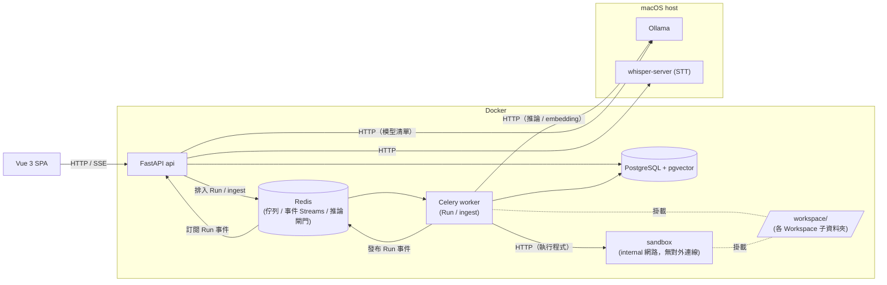
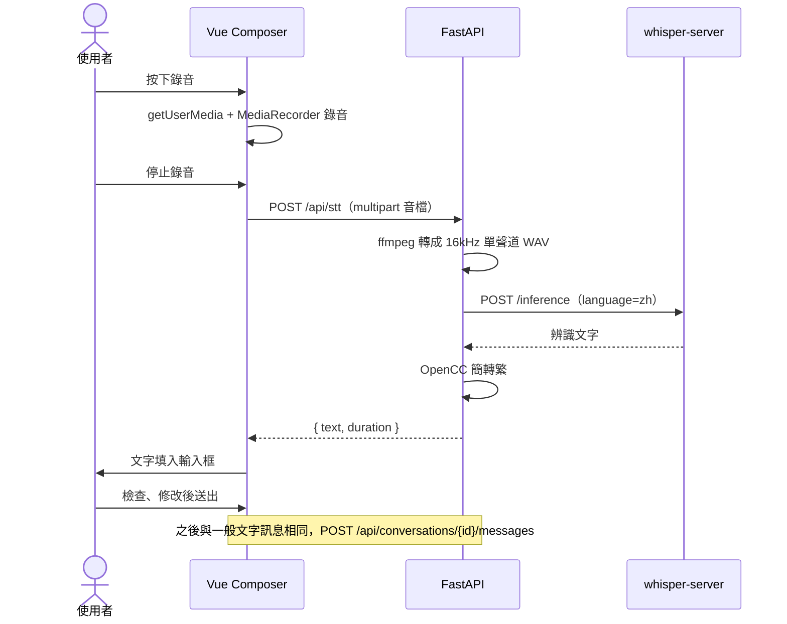

# Agent 平台｜系統規劃書 v0.2

> 術語定義見根目錄 [`CONTEXT.md`](../CONTEXT.md)；重大架構決策見 [`docs/adr/`](./adr/)。

**v0.2 主要變更**

- 對話與 Cowork 任務合併：每則 user 訊息觸發一個 Run，Cowork 是「綁定 Workspace 的對話」（ADR 0002）。
- 所有 Run 一律由 worker 執行，事件經 Redis Streams 轉發，前端改用 `GET` + `EventSource` 訂閱。
- L2 程式執行改用獨立的 sandbox 服務，不掛載 `docker.sock`（ADR 0001）。
- 新增 Workspace、Permission Ceiling、Allowlist Rule、Artifact 等概念與資料表；移除 `agent_tasks`。
- 依 DevNote 實際結構調整 RAG：不使用 front matter、改以資料夾路徑作為分類、不安裝 pg_bigm、加入評測集。

## 1. 目標與範圍

**目標**：基於 Ollama 提供之模型，搭配自建 Vue 3 前端與 FastAPI 後端，實作 ChatGPT / Claude 的網頁應用，並藉此學習地端模型的架設、串接與維運。

**三大功能**

1. 多模態對話
2. 知識庫 + RAG（第一個 Knowledge Source 為 DevNote 開發筆記庫）
3. Cowork：綁定 Workspace 的對話，agent 可在其中自主執行多步驟工作

**非目標（v1 不做）**：多人協作、商業化、行動 App、模型微調、雲端部署。

**設計原則**：單機優先；模型層可抽換（只依賴 Ollama 與 STT 服務的 HTTP API）；所有 agent 動作可追蹤、可中斷、可人工核准。

## 2. 模型與硬體策略

| 角色 | 用途 | 選型原則 |
|---|---|---|
| Chat 模型 | 對話、RAG 回答、agent 規劃 | 4B–12B 量化，需支援 tool calling |
| Vision 模型 | 圖片理解 | 可與 Chat 同一模型（若支援圖片） |
| Embedding 模型 | RAG 向量化 | 小型專用模型，全系統只用一個 |
| STT 模型 | 語音轉文字 | Whisper 系列（small ～ large-v3-turbo），需支援中英混合 |

- 24GB 統一記憶體，GPU 可用約 16GB 上下。模型加 KV cache 建議控制在 10–12GB 內。
- 同時載入多個模型會吃記憶體。Ollama 會依 `OLLAMA_KEEP_ALIVE` 卸載閒置模型，Chat 與 Embedding 切換會有載入延遲，需實測調整。
- 具體型號（Gemma 世代、是否支援 vision / tools、embedding 維度）待 P0 實測後定案，寫入設定檔，不寫死在程式。
- **模型能力標記**：設定檔中每個 Chat 模型標記 `tools`、`vision` 能力。綁定 Workspace 的對話只能選擇具備 `tools` 能力的模型；含圖片的訊息只能選擇具備 `vision` 能力的模型。
- **Embedding 模型全系統唯一**：寫在設定檔，目前使用的模型與維度記錄在 `system_meta`。更換模型時，知識庫與所有附件片段一律重算。
- Ollama 裝在 macOS 本機（才能用 Metal GPU），其餘服務走 Docker。
- Ollama 不提供語音轉文字，STT 另以 whisper.cpp 的 `whisper-server` 跑在 macOS 本機（同樣能用 Metal）。它會常駐載入模型，不像 Ollama 會自動卸載，需把它的記憶體（約 0.5–2GB，依模型大小）算進預算。

## 3. 整體架構



容器內以 `OLLAMA_BASE_URL=http://host.docker.internal:11434` 連到本機 Ollama，以 `STT_BASE_URL=http://host.docker.internal:<port>` 連到本機 whisper-server。

- **api**：處理 HTTP 請求、寫入 DB、排入工作、把 Run 事件轉成 SSE。除了查詢模型清單外，不直接呼叫 Ollama。
- **worker**：執行所有 Run（含一般聊天）與知識庫 ingest。Celery 分成 `runs`、`ingest` 兩個佇列，避免大量 ingest 卡住對話。
- **sandbox**：只接在 `internal: true` 的網路，只掛載 workspace，以 HTTP 接收要執行的程式碼（ADR 0001）。

## 4. 功能分析與可行性

### F1 多模態對話（可行性：高）

- **輸入**：文字、圖片、文件（txt、md、程式碼、PDF、Word、Excel）、語音。
- **輸出**：地端模型原生只輸出文字，v1 定義的「多模態輸出」為 Markdown 富文字、程式碼區塊、表格、Mermaid 圖，以及 Artifact（僅限綁定 Workspace 的對話）。
- **選配（後期）**：圖片生成與語音輸出（TTS）需另外的模型，與 Chat 模型同時跑會吃光 24GB，列為選配，不放進 v1。
- 對話體驗：串流、停止、重新生成、編輯後重送、自動產生標題、中途切換模型（下一個 Run 生效）。

#### 文件解析

PDF、Word、Excel 需先轉成文字才能交給 LLM。解析器使用現成套件，不自行實作檔案格式；自行實作的是外層的分派、正規化與長度控制。

- **統一介面**：`services/parsers/` 對外只提供 `parse(file) -> Markdown`，內部依 MIME 類型分派。v1 一律先用 MarkItDown（MIT 授權，PDF / DOCX / XLSX / PPTX 皆可轉 Markdown），品質不足的格式再單獨替換（PDF 可換 `pymupdf4llm` 或 Docling），呼叫端不需修改。
- **統一輸出 Markdown**：LLM 對 Markdown 理解良好，且可直接沿用 F2 依標題切塊的管線。
- **背景執行**：上傳後由 Celery worker（`ingest` 佇列）解析，`attachments.parse_status` 記錄 pending / done / failed / unsupported，前端顯示解析中狀態。
- **長度控制**：解析後計算 token 數。
  - 低於門檻（初值 4k tokens，依 `num_ctx` 調整）：全文放入 prompt。
  - 超過門檻：切塊、向量化後存為**附件片段**（`attachment_excerpts`），對話時只檢索本對話附件中的相關片段。附件片段只屬於該對話，不屬於知識庫；切塊與檢索程式碼與 F2 共用。
- **Workspace 對話的上傳**：在綁定 Workspace 的對話中上傳的檔案，除了照常解析供 prompt 使用，也會複製一份到該 Workspace 的 `uploads/` 下，讓工具（例如 L2 的 pandas）可以直接讀取。
- **Excel**：小表轉 Markdown 表格；大表只提供欄位名稱與前 N 列預覽。小模型讀大表、做計算都不可靠，實際分析交由綁定 Workspace 的對話以 L2 pandas 執行。
- **v1 不支援**：
  - 掃描檔 PDF：沒有文字層，需 OCR 或交給 vision 模型逐頁辨識，速度慢。解析結果為空時回報不支援。
  - 舊版 `.doc` / `.xls`：需先以 LibreOffice 轉檔。

#### 語音輸入

v1 只做「錄音 → 轉文字 → 送出」，不做即時邊講邊轉，也不保存音檔。



- **錄音**：瀏覽器以 `MediaRecorder` 錄音，Chrome 產出 webm/opus，Safari 產出 mp4/aac，因此後端要負責轉檔。`getUserMedia` 只能在安全環境（HTTPS 或 `localhost`）使用。
- **轉檔**：whisper.cpp 需要 16kHz 單聲道 WAV，api 容器需安裝 ffmpeg。
- **辨識**：同步請求，單次錄音上限 2 分鐘（初值），超過則前端自動停止。
- **簡繁轉換**：Whisper 的中文常輸出簡體，指定 `language=zh` 並以繁體 initial prompt 引導，最後再以 OpenCC 轉成繁體保底。initial prompt 也可放入常用技術名詞，改善專有名詞辨識。
- **先填入、不直接送出**：辨識結果填入輸入框讓使用者確認。中英夾雜的技術名詞容易辨識錯，直接送出會讓 LLM 根據錯字回答。
- **不採用瀏覽器 Web Speech API**：Chrome 的實作會把音訊送到 Google 伺服器，違反地端原則。

### F2 知識庫 + RAG（可行性：高）

知識庫是所有 Knowledge Source 的集合。第一個 Source 是 DevNote（`github.com/mirageapache/DevNote`），實際結構如下：

- Obsidian vault，19 篇筆記、約 29 萬字（約 15–25 萬 tokens），繁體中文夾雜英文技術名詞。
- 沒有 YAML front matter，也就沒有 tags。筆記格式為 `# 標題` → `>` 引言（說明目的與範圍）→ `---` → `##` 段落。
- 頂層資料夾以 emoji 前綴表示主題分類（例如 `⚙️DevOps 與部署`），檔名含中文、空格與 `[]`。
- `README.md` 是手動維護的目錄頁，另有 `CLAUDE.md`、`.obsidian/` 設定檔，還有少量 `[[wikilink]]`。

語料量雖小，總量仍遠超地端模型的 `num_ctx`（8k–32k），無法整包放進 prompt，因此 RAG 是必要的。

管線：

1. **取得來源**：`git clone / pull` 到本機資料夾（唯讀）。每個 Source 有自己的排除清單（存於 `kb_sources.config`），DevNote 預設排除 `README.md`、`CLAUDE.md`、`.obsidian/`。
2. **解析**：讀取 `.md`，取 `# 標題` 與開頭的 `>` 引言作為文件摘要，解析 `##` / `###` 標題階層。**Category** 為筆記在 Source 內的資料夾路徑（例如 `🗃️資料庫系統/MongoDB`），取代 tags。`[[wikilink]]` 保留為純文字。
3. **切塊**：依 `##` / `###` 標題切，每塊約 500–800 tokens、小幅重疊；程式碼區塊不可被切斷；每塊附 metadata（檔案路徑、Category、標題路徑、commit、mtime）。
4. **向量化**：呼叫 Ollama 的 embedding（全系統唯一模型），存入 pgvector。
5. **檢索**：向量 top 20 + 關鍵字 `ILIKE` top 20，以 RRF 合併，取前 5–6 塊（可選：再用 chat 模型重排）。
6. **生成**：把片段以 `[1] [2]` 編號放入 prompt，要求回答引用編號；後端發出 `citation` 事件，前端顯示來源晶片，可點開看原文。
7. **增量同步**：以檔案內容 hash 判斷新增 / 修改 / 刪除，只重算變動檔案。

**中文關鍵字檢索**：PostgreSQL 內建全文檢索對中文分詞很弱。v1 不安裝 pg_bigm / zhparser（需自訂 Postgres 映像），改以 `ILIKE` 子字串比對作為關鍵字檢索；語料小，循序掃描也夠快。若評測集顯示關鍵字召回不足，或語料大幅成長，再評估 pg_bigm。

**兩種使用方式**

| 對話類型 | 方式 | 說明 |
|---|---|---|
| 未綁定 Workspace | **Auto Retrieval（自動檢索）** | 每個 Run 開始前自動檢索、把片段放進 prompt。每個對話一個開關（預設開），範圍為全部 Source。 |
| 綁定 Workspace | `search_notes` 工具 | 不做自動檢索，由模型決定何時查詢，避免同一份內容重複佔用 context。 |

**評測集**：在 `api/tests/rag_eval/` 維護 20–30 題「問題 → 應命中的筆記」，以 recall@5 量測。P3 先量出基準值，之後每次調整切塊或檢索參數都重跑並與基準值比較。

### F3 Cowork（可行性：中，需分級達成）

定義：Cowork 是**綁定 Workspace 的對話**，不是獨立的實體。使用者在對話中下指令，agent 在 Workspace 內自行規劃、呼叫工具、產出 Artifact，過程可見、可中斷，危險動作需核准。

最大風險是 **4B–12B 小模型的 tool calling 與長流程穩定度**，不如雲端大模型。因此採分級：

| 等級 | 能力 | 工具 | 核准 |
|---|---|---|---|
| L0 | 唯讀研究：搜尋筆記、讀檔、整理摘要 | `search_notes`、`list_files`、`read_file` | 不需要 |
| L1 | 寫入 Workspace：產出報告、改檔 | `write_file`、`edit_file` | 預設需核准，符合 Allowlist Rule 者免核准 |
| L2 | 執行程式 | `run_python` / `shell`（sandbox 服務，無網路，限 CPU / 記憶體 / 時間） | 一律需核准，不可列入白名單 |

**Workspace**

- `workspace/` 下一個具名的子資料夾，是 agent 唯一能讀寫檔案的範圍。可被多個對話共用（例如「整理筆記 → 再改寫報告」沿用同一個 Workspace）。
- 對話的 Workspace 在第一則訊息送出後鎖定，不可更換，因為歷史訊息中的路徑都是相對於它的。
- 刪除 Workspace 時，若仍有對話綁定它，則禁止刪除並列出這些對話。

**Permission Ceiling（權限上限）**

- 對話層級的設定，代表允許使用的最高 Tool Level。超過上限的工具定義不會提供給模型；工具越少，小模型的 tool calling 越穩。
- 隨時可以調整，從下一個 Run 開始生效。

**Approval 與 Allowlist Rule**

- 核准的單位是單一工具呼叫，是否需要核准由工具本身的等級決定。
- **拒絕**不會終止 Run，而是把「被拒絕＋可選的理由」當作觀察結果回饋給模型，讓它換個做法。同一個 Run 連續被拒 N 次（初值 3）即終止。
- **Allowlist Rule** = 工具 + Workspace 內的路徑 glob（例如 `write_file` 對 `output/**`），設定在 Workspace 上，符合者免核准。L2 工具永遠不能列入。

**Artifact**

- 某個 Run 在 Workspace 中新增或修改的檔案，記錄於 `artifacts`，顯示在該 Run 的回覆下方，可預覽或下載。
- 重新生成或編輯後重送時，被取代的 Run 所產生的 Artifact **不會還原**；送出前列出這些檔案提醒使用者。（之後可考慮讓每個 Workspace 都是 git repo，每個 Run 自動 commit，以支援還原。）

Agent 迴圈：規劃 → 選工具 → 執行 → 觀察 → 重複，直到完成或達到最大步數。

可靠度設計（也是你的 agent reliability 方向的練習場）：

- 每步有逾時、重試（退避）、最大步數與總時間上限。
- 工具輸入用 Pydantic 驗證，格式錯誤時回饋給模型重試有限次數。
- 所有 Step 寫入 `steps`，可重播、可除錯。
- Run 可取消，取消時中止對 Ollama 的請求與 sandbox 中的執行。
- 路徑一律限制在 Workspace 內（防 path traversal 與 symlink 逃逸）。
- **Prompt injection 的影響範圍**：筆記與檔案內容都可能含有注入指令，無法靠規則禁止它們「觸發動作」。防線在於：Allowlist Rule 只能涵蓋 Workspace 內的寫入、L2 一律人工核准，因此注入的最大傷害被限制在 Workspace 內。

## 5. 後端規格（FastAPI）

**技術**：Python 3.12、FastAPI、SQLAlchemy 2.0（async）、Alembic、httpx、Celery + Redis、Pydantic v2。

### 模組結構

```
api/app/
  main.py  core/(config, logging)
  routers/(conversations, messages, runs, uploads, stt, models, kb, workspaces)
  services/
    ollama_client.py    # 唯一與 Ollama 溝通的地方
    stt_client.py       # 唯一與 whisper-server 溝通的地方（含 ffmpeg 轉檔、OpenCC）
    inference_gate.py   # Redis 推論閘門（跨行程、具優先序）
    run/(executor, prompt_builder, events)   # Run 執行、prompt 組裝、事件發布
    parsers/            # parse(file) -> Markdown，依 MIME 分派
    rag/(ingest, chunker, retriever)
    agent/(tools, policy, sandbox_client)    # 工具定義、核准與白名單判斷、呼叫 sandbox
  db/(models, session)   schemas/(含 events.py：SSE 事件定義)   workers/(celery_app, tasks)
```

### Run 執行模型

- 每則 user 訊息觸發一個 Run。**一個對話同時只能有一個進行中的 Run**（DB 以部分唯一索引保證），進行中時送出新訊息會回 409。
- Run 一律由 worker 執行。執行過程的事件寫入 Redis Streams（每個 Run 一個 stream），api 的 `GET /api/runs/{id}/events` 讀取該 stream 並轉為 SSE，支援 `Last-Event-ID` 接續；重新整理頁面後可以繼續訂閱進行中的 Run。
- **取消**：只有 `POST /api/runs/{id}/cancel` 會取消 Run；客戶端斷線不會中止 Run。
- **等待核准**：Run 進入 `awaiting_approval` 狀態，釋放推論閘門，結束目前的 Celery 工作（不佔用 worker）。核准或拒絕後重新排入一個接續工作，從 `steps` 重建上下文繼續執行。等待核准沒有逾時，由使用者自行取消。

Run 流程：

1. 存 user 訊息，建立 Run（`queued`）並排入 `runs` 佇列
2. （未綁定 Workspace 且開啟自動檢索）檢索知識庫
3. 組 prompt（見下方）
4. 取得推論閘門，串流呼叫 Ollama；綁定 Workspace 時附上權限上限以內的工具定義，進入 agent 迴圈
5. 將 token、Step、核准、Artifact 等事件發布到 Redis Stream
6. 完成後存 assistant 訊息與耗時、tokens/s，記錄 Artifact，第一個 Run 完成後產生標題

### Prompt 組裝

順序：system + 歷史 + 附件內容 + 知識庫片段（僅自動檢索），依 token 預算截斷最舊的訊息。

- **圖片**：只有「最近一則帶圖片的 user 訊息」送出原圖；更早的圖片改成文字佔位，例如 `[圖片：screenshot.png]`。模型對舊圖片的理解已保存在它當時的回覆裡。
- **全文附件**：在 token 預算內每回合都帶上；預算不足時，從最舊的附件開始降級為附件片段檢索，而不是直接丟棄。
- **被取代的訊息**（`superseded_at` 不為空）不納入歷史。

### 重新生成與編輯後重送

訊息結構為線性。編輯第 k 則等於把 k 之後的所有訊息標為被取代，再以新內容建立 Run；重新生成等於把最後一則 assistant 訊息標為被取代，再建立 Run。被取代的訊息採軟刪除（`superseded_at`）。之後若改成分支樹，只需加上 `parent_id` 做遷移。

### API 清單

| Method | Path | 說明 |
|---|---|---|
| GET / POST | /api/conversations | 列表 / 建立（可指定 Workspace、權限上限、模型） |
| GET / PATCH / DELETE | /api/conversations/{id} | 讀取 / 修改標題、模型、權限上限、自動檢索開關（Workspace 在第一則訊息後不可改）/ 刪除 |
| GET | /api/conversations/{id}/messages | 訊息列表（含被取代標記） |
| POST | /api/conversations/{id}/messages | 送出訊息並建立 Run，回傳 `run_id`；已有進行中的 Run 時回 409 |
| POST | /api/messages/{id}/regenerate | 重新生成 |
| POST | /api/messages/{id}/edit | 編輯後重送 |
| GET | /api/runs/{id} | Run 狀態與 Steps |
| GET | /api/runs/{id}/events | SSE Run 事件（支援 `Last-Event-ID`） |
| POST | /api/runs/{id}/steps/{n}/approve | 核准 / 拒絕（附可選理由） |
| POST | /api/runs/{id}/cancel | 取消 Run |
| POST | /api/uploads | 上傳圖片 / 文件（文件於背景解析；Workspace 對話另複製到 `uploads/`） |
| GET | /api/uploads/{id} | 查詢附件與解析狀態 |
| POST | /api/stt | 上傳音檔，回傳辨識文字 |
| GET | /api/models | 模型清單與能力（`tools` / `vision`） |
| GET / POST | /api/workspaces | 列表 / 建立 |
| DELETE | /api/workspaces/{id} | 刪除；仍有對話綁定時回 409 並列出這些對話 |
| GET | /api/workspaces/{id}/files | 檔案樹 |
| GET | /api/workspaces/{id}/files/{path} | 預覽 / 下載檔案 |
| GET / POST / DELETE | /api/workspaces/{id}/allowlist-rules | 管理 Allowlist Rule |
| POST | /api/kb/sources | 新增 Knowledge Source（git / 資料夾） |
| POST | /api/kb/sources/{id}/sync | 觸發同步（背景工作） |
| GET | /api/kb/search?q= | 檢索除錯 |

### 串流事件（SSE）

- 所有串流都是 `GET /api/runs/{id}/events`，前端可直接使用 `EventSource`，斷線時自動以 `Last-Event-ID` 重連。
- Run 事件：`queued`（含排隊位置）、`run_start`、`token`、`citation`、`step_start`、`tool_call`、`tool_result`、`approval_required`、`artifact`、`title`、`run_done`、`error`。
- 實作：用 FastAPI 的 `StreamingResponse`（`media_type="text/event-stream"`），或 `sse-starlette` 套件。

### 併發與資源

- **推論閘門**：單機 GPU 只適合低併發。以 Redis 實作跨行程的推論閘門（同時推論數預設 1–2），優先序為：未綁定 Workspace 的對話 Run > Cowork Run > ingest（embedding）。排隊中的 Run 發出 `queued` 事件回報排隊狀態。
- 設定集中管理：模型名稱與能力標記、`num_ctx`、temperature、檢索參數、`KEEP_ALIVE`、Run 的最大步數與總時間、連續拒絕上限。

## 6. 前端規格（Vue 3）

**技術**：Vue 3 + Vite + TypeScript、Pinia、Vue Router、Tailwind（或你的設計系統）、markdown-it + Shiki（程式碼高亮）、Mermaid。

串流：送出訊息是一般的 `POST`，回傳 `run_id` 後，以 `EventSource` 訂閱 `GET /api/runs/{id}/events`。不需要自行解析 `fetch` 串流；斷線重連與 `Last-Event-ID` 由瀏覽器處理。

### 頁面

| 路由 | 內容 |
|---|---|
| /chat/:id? | 對話主畫面（側邊欄歷史 + 訊息區 + 輸入區）。綁定 Workspace 的對話，訊息中會顯示 Step 時間軸、核准與 Artifact，並可展開檔案樹 |
| /workspaces | Workspace 管理、Allowlist Rule 設定 |
| /knowledge | Knowledge Source 管理、同步狀態、檢索測試 |
| /settings | 模型、參數、system prompt、主題 |

### 主要元件

`ConversationList`、`MessageList`、`MessageItem`（Markdown 渲染）、`Composer`（多行輸入、圖片 / 文件預覽、拖曳 / 貼上、錄音、送出 / 停止）、`VoiceRecorder`（錄音、計時、上限自動停止）、`CitationChip`、`ModelPicker`（依能力過濾）、`WorkspacePicker`、`PermissionCeilingPicker`、`RunTimeline`（嵌在 `MessageItem` 內）、`ApprovalDialog`、`FileTree`、`ArtifactViewer`。

### 狀態（Pinia）

`conversationStore`、`runStore`（訂閱中的 Run、事件、EventSource 連線）、`kbStore`、`workspaceStore`、`settingsStore`。

### UX 要點

- 串流中逐 token 渲染但避免整段重繪；自動捲動可被使用者打斷。
- 顯示模型載入中、排隊中、出錯的狀態。
- Run 進行中（包括等待核准），輸入框只保留「停止」。
- 重新整理頁面後，自動接續訂閱進行中的 Run。
- 重新生成或編輯後重送時，若被取代的 Run 產生過 Artifact，先列出這些檔案提醒使用者。
- 顯示文件解析中 / 失敗、錄音中 / 辨識中的狀態；文件解析完成前不可送出。
- 引用來源以晶片顯示，Cowork 的每一步可展開看輸入與輸出。

## 7. 資料庫規格（PostgreSQL 16 + pgvector）

使用 Alembic 管理遷移。單人使用，但各主表預留可為空的 `user_id`，方便日後擴充。

| 表 | 主要欄位 |
|---|---|
| conversations | id (uuid), title, model, system_prompt, workspace_id (FK, nullable；第一則訊息後鎖定), permission_ceiling (L0 / L1 / L2, nullable), auto_retrieval (bool, 預設 true), created_at, updated_at |
| messages | id, conversation_id (FK), role, content, status (streaming / complete / error / cancelled), superseded_at (nullable), model, meta (jsonb：citations、tokens/s、耗時), created_at |
| runs | id, conversation_id (FK), user_message_id (FK), assistant_message_id (FK, nullable), model, status (queued / running / awaiting_approval / done / failed / cancelled), error, created_at, finished_at |
| steps | id, run_id (FK), step_no, type (model_call / tool_call), tool_name, tool_level, input (jsonb), output (jsonb), status (pending_approval / approved / rejected / running / ok / failed), rejection_reason, duration_ms, created_at |
| workspaces | id, name, path (`workspace/` 下的相對路徑), created_at |
| allowlist_rules | id, workspace_id (FK), tool_name, path_glob, created_at |
| artifacts | id, run_id (FK), workspace_id (FK), path, change (created / modified), sha256, size, created_at |
| attachments | id, message_id (FK, nullable：上傳時尚未綁定訊息), kind (image / document), path, mime, size, sha256, parse_status (pending / done / failed / unsupported), text_path (解析後的 Markdown), workspace_copy_path (nullable), token_count, created_at |
| attachment_excerpts | id, attachment_id (FK), chunk_index, content, token_count, embedding (vector(N)) |
| kb_sources | id, name, type (git / folder), uri, branch, last_commit, last_synced_at, status, config (jsonb：排除清單等) |
| kb_documents | id, source_id (FK), path, sha256, title, summary, category, mtime, status |
| kb_chunks | id, document_id (FK), chunk_index, heading_path, content, token_count, embedding (vector(N)) |
| system_meta | key, value（例如 `embedding_model`、`embedding_dim`） |

**索引與約束**

- `messages (conversation_id, created_at)`
- `runs (conversation_id)` 部分唯一索引，條件為 `status IN ('queued', 'running', 'awaiting_approval')`，保證一個對話同時只有一個進行中的 Run
- `steps (run_id, step_no)`
- `artifacts (run_id)`
- `workspaces` 唯一 `(name)`
- `kb_documents` 唯一 `(source_id, path)`
- `kb_chunks.embedding` 使用 HNSW（cosine）。附件片段的檢索範圍限定在單一對話，資料量小，不建向量索引

**刪除規則**

- 刪除對話：連帶刪除其訊息、Run、Step、附件、附件片段與 Artifact 紀錄。Workspace 及其中的檔案保留。
- 刪除 Workspace：仍有對話綁定時禁止（`ON DELETE RESTRICT`）。

**注意**：向量維度 N 取決於全系統唯一的 embedding 模型（記錄於 `system_meta`），更換模型需重算 `kb_chunks` 與 `attachment_excerpts`。圖片、文件與解析後的 Markdown 存在 Volume，資料庫只存路徑。語音音檔在辨識後即刪除，不入庫。

## 8. 專案結構與部署

採 monorepo：前後端分離是架構層面（SPA + API），程式碼放在同一個 repo。單人開發、前後端常需同步修改（API schema、SSE 事件），同一個 commit 即可改完，不會有版本對不上的問題。

```
AgentPlatform/
  CONTEXT.md            # 術語表
  docs/
    spec.md             # 本文件
    adr/                # 架構決策紀錄
  api/                  # FastAPI + Celery（uv + pyproject.toml）
    app/  alembic/  tests/(含 rag_eval/)
  web/                  # Vue 3（package.json）
    src/
  sandbox/              # sandbox 服務（接收並執行程式碼）
  docker/               # 其他自訂映像
  docker-compose.yml
  Makefile              # 統一指令入口
  .gitignore            # 排除 data/、workspace/、.env
  workspace/            # 各 Workspace 子資料夾（掛載，不進版控）
  data/uploads/         # 使用者上傳（不進版控）
  data/kb/              # 知識庫 git 副本（不進版控）
```

**Monorepo 慣例**

- **不使用 monorepo 工具**：Nx、Turborepo、pnpm workspaces 是為管理多個 JS 套件設計的，本專案只有一個 Python 專案與一個前端專案，用不到。
- **相依套件各自管理**：`api/` 用 `uv`，`web/` 用 npm 或 pnpm。
- **統一指令入口**：根目錄 `Makefile` 提供 `make dev`、`make test`、`make migrate`、`make gen-types`、`make rag-eval` 等指令。
- **前後端型別同步**：以 `openapi-typescript` 讀取 FastAPI 的 `/openapi.json`，產生 `web/src/api/types.ts`（`make gen-types`）。後端改了 Pydantic schema，前端重新產生後即可在編譯時發現型別錯誤。
- **SSE 事件型別**：SSE 事件不會出現在 OpenAPI 文件中，事件格式在後端以 Pydantic model 定義（`schemas/events.py`），前端對應型別另行維護，兩邊需在同一個 commit 修改。
- **CI（若導入 GitHub Actions）**：以路徑過濾，只改 `web/` 時不跑 Python 測試，只改 `api/` 時不跑前端測試。

**部署**

Compose 服務：`db`（pgvector 映像）、`redis`、`api`、`worker`（與 api 同一映像）、`sandbox`（只接 `internal: true` 網路，只掛載 `workspace/`）。前端開發時直接在本機 `npm run dev`。Ollama 與 whisper-server 不放進 Docker（Mac 容器用不到 GPU）。`api` 映像需安裝 ffmpeg。

## 9. 開發路線（時間為粗估）

| 階段 | 內容 | 驗收 |
|---|---|---|
| P0（約 1 週） | 安裝 Ollama 與 whisper.cpp，實測 4B–12B 模型的記憶體、速度、vision、tool calling、embedding，以及 Whisper 各尺寸的中英混合辨識率與速度 | 決定模型清單與能力標記（含 STT 模型）、`num_ctx` |
| P1（2–3 週） | Run 執行模型（Celery worker、Redis Streams、推論閘門）+ 前端聊天 + 對話存 DB | 能穩定多輪對話、可停止、重新整理後可接續進行中的 Run、可載入歷史 |
| P2（2–3 週） | 圖片 / 文件輸入、文件解析、附件片段、語音輸入 | 貼圖提問可得到合理回答；上傳 PDF / Word / Excel 可針對內容提問；錄音可轉成正確的繁體文字 |
| P3（2–3 週） | 知識庫同步、切塊、混合檢索、自動檢索、引用顯示、評測集 | 評測集建立完成並量出 recall@5 基準值；針對筆記提問，回答附正確來源 |
| P4（2–3 週） | Workspace、權限上限、L0 工具、Step 時間軸 | 在綁定 Workspace 的對話中完成「整理某主題筆記成摘要」 |
| P5（3 週以上） | L1 / L2 工具、核准流程、Allowlist Rule、sandbox 服務、Artifact | 產出 Artifact，並可核准或拒絕每個動作；被拒絕後模型能改變做法 |

## 10. 風險與待決事項

1. **小模型 agent 穩定度**：可能需要更嚴格的工具 schema、更短的步驟與更多重試；以權限上限減少提供給模型的工具數量；必要時 Cowork 只做 L0–L1。
2. **記憶體壓力**：RAG 片段、長歷史與圖片會放大 KV cache，需限制 `num_ctx` 與檢索片段數，舊圖片以文字佔位取代。
3. **檢索品質**：`ILIKE` 能比對中文子字串，但沒有相關性權重；以評測集量化，若關鍵字召回不足再評估 pg_bigm。
4. **安全**：sandbox 隔離、Workspace 路徑限制、核准機制，任何一項偷懶都可能讓 agent 動到不該動的檔案。sandbox 為常駐容器，兩次執行之間可能殘留暫存檔或行程，需在每次執行後清理或定期重啟。
5. **Run 的暫停與續跑**：等待核准時要把 Run 的狀態完整寫入 DB，核准後再從 `steps` 重建上下文，實作比單一迴圈複雜，需要測試中斷與續跑的各種情境。
6. **模型選型**：Gemma 新世代的尺寸、vision 與 tool calling 支援度，以 P0 實測為準。
7. **語音辨識品質**：中英夾雜的技術名詞容易辨識錯，簡繁轉換也可能轉錯詞；以「先填入輸入框讓使用者修改」降低影響。
8. **文件解析品質**：MarkItDown 對 PDF 的標題與表格還原有限，若 P2 實測不足，PDF 改用 `pymupdf4llm`（AGPL 授權）或 Docling（較重、較慢）。

### 下一步

- 完成 P0 實測，回填第 2 節的模型清單與能力標記。
- 撰寫 RAG 評測集的題目與標準答案。
- 之後可再細化：API 請求 / 回應 schema、資料表 DDL、工具定義與 prompt。
